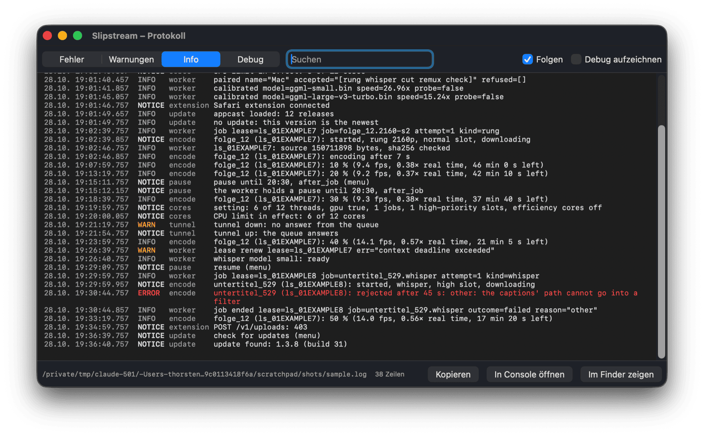
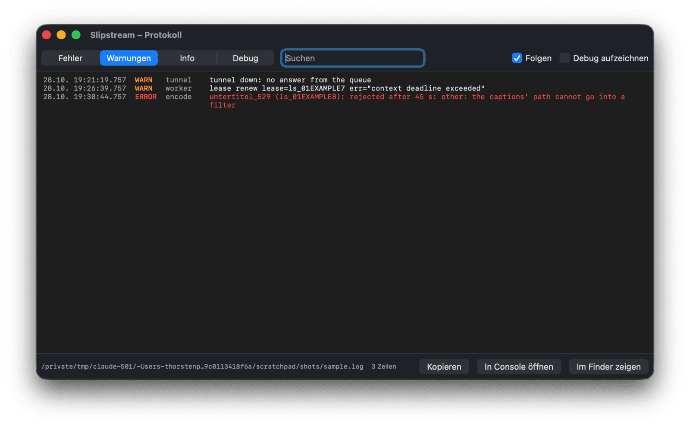

# Logging

Slipstream logs every line twice: to macOS's unified log and to a file. The log window reads the
file. The code is `App/Slipstream/Log.swift` (where lines go) and `HelperCore/Logging.swift`,
`HelperCore/EventLog.swift` (what they say, tested in `LoggingTests`).

## Where the lines go

- **The unified log**, subsystem `io.github.kyrios.slipstream`, the bundle id. Console.app shows
  it live; in a terminal:

  ```
  /usr/bin/log show --last 1h --info --predicate 'subsystem == "io.github.kyrios.slipstream"'
  /usr/bin/log stream --level debug --predicate 'subsystem == "io.github.kyrios.slipstream" AND category == "encode"'
  ```

  macOS keeps notice, error and fault lines for days. It keeps info lines only for a short time,
  and debug lines only while `log stream` runs.
- **The file**, `~/Library/Logs/Slipstream/slipstream.log`. At 5 MB it moves to `.1`, `.1` to `.2`
  and so on, up to `.4`. That is 25 MB at most. Console.app lists the folder under
  "Log Reports". Older versions wrote `worker.log`, with the worker's lines only; the app
  leaves that file alone.

  ```
  2026-10-28T19:08:35.204Z NOTICE worker    worker started, pid 2188
  2026-10-28T19:08:35.281Z INFO   worker    encode-worker up version=v0.2.18 name="Mac Studio"
  2026-10-28T19:26:49.836Z NOTICE encode    one_144 (ls_01…): started, rung 2160p, normal slot
  ```

  The time is UTC. The level is `DEBUG`, `INFO`, `NOTICE`, `WARN`, `ERROR` or `FAULT`, and the
  category comes next. Both are padded, so the messages start in one column.

Debug lines reach the file only while **Debug aufzeichnen** in the log window is on. It is off
by default and kept in the defaults (`logDebug`). The Debug menu preview (`-menuPreview`) writes
no lines at all, because the log belongs to the Slipstream that is running.

## Levels and categories

| level | unified log | for |
|---|---|---|
| debug | debug | each worker event, each command to the worker, each request of the Safari extension that succeeds, Sparkle's next check |
| info | info | a job's phases and each 10 %, the worker's own info lines, the job lines, a check without an update |
| notice | default | a change of state: start and quit, the tunnel up, a job started or ended with its time, a pause and its source, a CPU setting, the limit in effect, an update found, the extension connected, a refused request |
| warning | error | the tunnel down, a job kind the queue refuses, a line on the worker's standard error in no known form, a main thread that waits 100 ms or more |
| error | error | a failure and its cause: a rejected job, a stopped worker, the keychain, a failed update check |
| fault | fault | Slipstream cannot do its work: the loopback does not start, the worker panics |

A warning goes to the unified log at error level, as `Logger.warning` does; the file and the
window keep it apart.

Categories: `app` (start, quit, the site, the login item, the watchdog), `tunnel` (pairing,
the key, the tunnel's state), `worker` (the process and its own lines), `encode` (the queue's
jobs and the ProRes jobs), `update`, `extension` (the loopback and Safari's extension), `pause`,
`cores`.

**No secrets.** The loopback token, the WireGuard private key and passwords are never logged. A
line goes to the unified log as public, so Console.app shows it in full. As a safety net,
`LogRedaction` replaces a value after `token`, `secret`, `password`, `private_key`,
`authorization` or `cookie`, and the user part of a URL, with `<privat>`. A public key, a host
or an address stays as it is.

## The worker's lines

The worker writes Go's log/slog text form to its standard error:
`time=… level=INFO msg="job ended" lease=… outcome=…`. Slipstream takes the level from `level=`
(`DEBUG`, `INFO`, `WARN`, `ERROR`, and slog's offsets such as `INFO+2`). It keeps the message and
its attributes and drops the time, because the file has its own: `job ended lease=… outcome=…`.
A line in another form is a fault when it starts `panic:` or `fatal error:`, an error when it
starts `encode-worker:` (the worker's last word), and otherwise a warning.

A job's lines (`log` events on standard output, such as the ffmpeg command or "source … bytes,
sha256 checked") carry no level up to encode-queue v0.2.18, so they are info. A `level` field in
the event, a slog level word, sets the level once the worker sends one (docs/worker.md).

## What is logged

`WorkerEventLog` turns the worker's events into lines, each change once. A running job sends an
event every second, so this matters:

- the tunnel up and down, and a job kind the queue refuses;
- a job started (title, lease, kind, rung, slot), each new phase with the time so far, each 10 %
  with fps, speed and time left, and its end: accepted, rejected with the check's reason,
  preempted or given back, each with the job's time; a job that ends without a result at `idle`;
- the pause the worker holds, the CPU limit in effect, a whisper model's state, the tools, a
  newer app the queue wants.

The app adds: its start and quit, the site, the worker's start, stop and restart with the
reason, a pause or resume with its source (`menu`, kept from the last run, its end), each CPU
setting, Sparkle's checks and their outcome, the Safari extension's first contact after a start
or after ten minutes without one, pairing, keychain and loopback failures, each ProRes job's
phases, every 10 % and its time.

## The log window

"Protokoll anzeigen …" opens it (`LogWindow.swift`). It reads the file's last 2 MB and then,
every half second, what was added, across a rotation (`LogTail`). It holds at most 20,000 lines.

- **Fehler / Warnungen / Info / Debug**: each shows its level and the ones above it. The choice
  is kept (`logFilter`).
- **Suchen**: the lines whose message or category contains the text, ignoring case.
- **Folgen** keeps the newest line in view. Scrolling up with the wheel, the trackpad or the
  scroller turns it off; scrolling back to the end turns it on again (`LogFollow`).
- **Debug aufzeichnen**: see above.
- **Kopieren** copies the lines the window shows, as it shows them (⌘C copies a selection).
- **In Console öffnen** opens the file in Console.app; **Im Finder zeigen** selects it.





**Looking at the window beside a running Slipstream.** A Debug build started with
`-menuPreview YES -logWindowFile docs/logging/sample.log -openLog YES` shows the window on the
sample lines and writes nothing. With `-logRender <file.png>` in place of `-openLog YES`, it
saves the window as the window server draws it and quits. That is how the pictures above were
made (`-logFilter warnings` for the second). The sample lines are made up.
